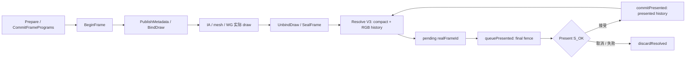

# OIT material RGB history

当前 native 实现提供有界 fragment records、不可变 producer/primitive 语义、GPU compact、逐 surface 材质 RGB 历史与 Resolve V3。生产主循环的启用由 JVM 帧编排负责；本模块不会自行替换原透明合成，alpha/coverage AA 与 FG 分层尚未实现。

`include/mcdr_abi.h` 是 CPU ABI、producer kind、结果码与状态位的唯一来源。顶层 ABI 25；Resolve 使用 schema 3，terrain Begin/metadata/draw 使用 schema 2，其余 OIT CPU 契约保持 schema 1。`include/mcdr_oit_shader.h` 独占 shader ABI 5、144 B record、8 B pixel 存储与 shader contract hash。`McdrOitFragmentV1`、`AppendV1` 保留源码名称。调用内复制 metadata，不保留 JVM Arena 指针。

世界输出使用 `mcdr_world_output_input` schema 3、360 B，尾部追加 `sourceStage` 与零值 `reservedStage`。`COMPLETE_WORLD` 在 WorldReady 后运行整幅世界重建；`OPAQUE_BEFORE_COMPOSITE` 在 Recording 内对不透明层运行曝光、可选 provider mask、重建与场景转存，随后保持 OpaquePost，允许继续录制云、透明物体、粒子、天气及 OIT Resolve。它不要求透明捕获已 seal。完整世界合成完成后，调用 WorldReady 将 OpaquePost 转为 WorldPost，再进入 GUI；该调用检查不透明输出已完成，禁止第二次重建。首次无前帧时仍按原规则复制当前不透明层，透明合成的顺序保持一致。普通 draw、terrain WG 与 OIT 继续使用同一冻结资源版本和 declared-pass 调度。

Vanilla frame 默认仅保存内嵌的 world-depth 注册、clear/write 计数、注册前是否发生 depth 命令和关闭状态；未启用 opaque seed consumer 时不分配事件表、descriptor heap、packet 或逐 draw 租约。world depth 只接受 `setRasterMotionTarget` 的真实注册，注册前发生 depth 命令会阻止后续 arm，注册后其它 DSV 不计入 seed。

native 模块内部的 `armWorldDepthSeedCaptureV1` 要求在首个 depth clear/write 前调用，显式提交帧/recording/fence/submission 身份、真实 world depth、已发布的 frame-program generation、预算、maxEvents 和完整 graphics observer。已有 observer 时返回 Busy，不覆盖对方；晚启用返回 LateArm。创建失败只释放候选，不改变普通帧或绑定 observer。成功后由该入口绑定所给 observer，seal/cancel 只解绑同 owner、回调、预算和内容策略的绑定。graphics observer 默认 `FactsOnly`，不会在当前没有 executor 的情况下触发内容冻结；未来 executor 必须显式请求 `FreezeBindings` 并在同 recording 消费冻结绑定。重复 seal 仍核对帧与 recording 身份，过期时返回 StaleRecording；已封口 capture 的 cancel 返回原状态，不把 Ready 改报成 Cancelled。当前生产代码没有 arm 调用，也没有 opaque seed executor，因此 `GAP_OPAQUE_SEED` 保持缺失。

arm 后按实际事件数量增长 `WorldDepthSeedJournal`，vector 扩容前申请预算，迁移期间旧/新容量同时计费，超过 maxEvents 或预算使 recordingFailed。depth owner 只创建一次，journal、consumer 与实际 packet 由 command-list recording leases 持有到对应 fence；reset/cancel 不提前释放，提交未知保留原租约。事件保存实际 PSO 的强引用、不可变 pipeline 创建 generation、consumer program generation、真实 depth 子资源/DSV 描述和源句柄；journal 另保留不复用的等价 DSV。draw packet 必须来自 arm 提供的 observer，并匹配实际 recording、PSO 与命令类型，缺项使 capture incomplete 并拒绝提交。资源保活不冻结内容，四 lane replay 仍需完整内容冻结和执行契约。

实际 IA、indirect、mesh 与主 `drawTerrainWorkGraph` 的 ExecuteIndirect 都报告 depth writer；WG 使用真实 Mesh 命令类型和原 graphics packet，tile replay 不反写 opaque seed。`LevelRendererOitProducerMixin` 在 `executeOit` HEAD 调用 `captureOpaqueAndBeginRecords`，先复制不透明输入，再进入 native OIT `beginFrame`。seed 在该 `beginFrame` 的首次 OIT GPU 命令前封口并移交给 OIT Frame；之后的 water mask、depth cull、accumulate 不再进入 seed。`prepareComposite` 才调用的 `prepareWorldOutput(OPAQUE_BEFORE_COMPOSITE)` 已晚于这些命令，只检查已 arm capture 是否漏封口，不再补封口。没有 OIT 或没有 arm 的普通帧继续使用轻量路径，WorldReady 关闭轻量记录；已 arm 却跳过 OIT begin 的路径取消 capture 并拒绝本帧。

`WorldDepthSeedJournalV1` 是 native vanilla 模块导出的只读事实，包含完整 FrameInput、recording identity、fence/submission、真实 world depth owner、独立 DSV heap/句柄和有序 clear/draw 事件。事件携带 clear depth/rect、depth 子资源与源 DSV、实际 PSO 强引用、pipeline identity、shader/program generation、命令族/ordinal 和原 packet。`readWorldDepthSeedCaptureV1` 每次清空输出，核对同 recording/fence/submission 与 frame/depth/program 身份，仅在 closed、Ready 且录制正常时返回 const journal；打开状态返回 Busy，过期返回 StaleRecording，取消、预算与录制失败保留对应 typed 状态。OIT begin 验证 journal 与本 Frame 的身份及事件事实，再保存共享所有权。opaqueDepth 是 JVM 已复制的不透明纹理，真实 seed depth 按 world-depth 注册身份验证，不拿复制纹理冒充原 DSV。

生产 arm 需要未来 executor 在 world frame 已冻结、真实 world depth 已注册且首次 clear/write 之前建立 consumer 和完整 observer，并由 arm 保留 owner；到 OIT begin 封口后，consumer 根据只读 journal 继续冻结内容与四 lane 执行。目前没有这个 executor，生产不自动 arm，也不启用昂贵逐 draw 捕获。journal 与 OIT Frame 的引用不会早于 recording lease/fence 释放；取消与 reset 只关闭入口，提交未知继续保留实际资源。seal 只确认已收集事件，不发布 executor 成功，也不清 `GAP_OPAQUE_SEED`、normalization 或覆盖缺项。

capture PSO 使用独立工厂，根参数追加在既有 push constants 之后。space2 的 b0 为 208 B 常量；11 个 SRV 中 t0/t1/t2 保存 RAW source/primitive/previous 与原 section 索引，t9/t10 保存 current/previous terrain section；u0/u1/u2 是 RAW records、pixel 状态与 allocator。每次 BindDraw 只允许一次实际 native draw，WG 的一次 ExecuteIndirect 可覆盖整批 mesh。capture 前保存并解绑 SRI，强制 1×1 与 PASSTHROUGH VRS，退出恢复原绑定。native 反射要求 early depth、pixel frequency、仅颜色输出、匹配常量与三个 RAW UAV；PSO 固定单 sample 且禁止 depth write。设备必须支持 `SV_Barycentrics`。

每帧拥有独立的 draw 常量页，每页是 64 KiB、持续映射的 UPLOAD buffer，预算按页计费。BindDraw 依次使用 256 B 对齐的独占 slice，写入 208 B capture 常量，通过页 GPU VA 加偏移绑定 CBV；每页容纳 256 次 draw，不覆盖已录制 slice。initialize/resolve 使用原独立 constants buffer，不与 draw 页混用。Frame 通过 `unique_ptr` 容器保持页地址稳定；DrawLease 只持有 Frame，由当前 command-list 槽的 recording lease 保留到对应 fence 完成，Frame 不反持有 DrawLease。presented/pending/history 引用可能延长 Frame 与页的寿命，全部受同一 512 MiB 预算约束。页分配预算不足返回 overBudget，不插入等待，也不改变 records 配额。

144 B 私有 records 保存 chunk 混合前 material RGB、当前 sampleAlpha、transmittance、depth/梯度、UV/梯度、geometry/material 两套 previous UV/depth、coverage/validity、fog factor、chunkVisibility、material previous UV 的屏幕梯度，以及稳定 RGB/history length。原 finalQ、materialAlpha、accumAlpha、response、fog RGB 的 finite 校验保留，只取消从未读取的 GPU 存储；scope serial 继续参与 CPU 绑定校验。CPU previous triangle 仍为 80 B。记录里的 previous 指本帧提交的前帧三角几何；HistoryState 的 presented 才是已显示的前帧 GPU records。

8 B pixel 状态保存完整 uint32 head 与打包 count/status：count 占低 8 位，实际每像素上限保持 32。Append 对完整 packed word 做 CAS，失败后用 observed 重试，保留并发 OR 的状态位；compact 在 capture 结束后写回认证状态。未被消费的 compact offset 已移除，allocator 的索引表保持原样。当前 FP32 精度、records/metadata 容量和 pending/Present 生命周期保持原契约。

metadata 行容量不足使用专用结果 `MCDR_OIT_RESULT_METADATA_CAPACITY_EXCEEDED`（-7），在完整输入校验之后、任何旁表变更之前返回；调用方可在 capture PSO 绑定前改用真实未记录覆盖。资源分配或共享预算不足继续返回 -3，中止当前帧，不能作为未记录 draw 继续执行。ABI20 默认配置在 4K 下基础 Frame 为 121.0625 MiB；ABI21 的 BeginV2 另为有界 terrain section buffer 申请额度，draw 常量页继续按需计费，所有 reservation 共用 512 MiB 上限。更多在途 Frame、其他 context 或重叠 program 均消耗该额度，不能沿用旧四帧估算作为完整新路径的峰值。

terrain 用 80 B GPU section 表代替逐三角形 previous：保存 surface/material generation、逻辑 primitive 范围、真实 VBO 顶点范围和 previous 相对原点。metadata 同步复制 CPU section 行并保留真实 VBO 租约；实际 terrain draw 核对 VBO/偏移后消费绑定。MS 从同代静态顶点计算 previous clip，材质 previous 复用同一 UV；几何 generation 变化清 geometry/material previous，材质或 texture generation 变化只清 material previous。`identity.z` 最高位标识 terrain，其余 31 位为帧内逻辑 primitive，通过有序 prefix 二分定位 section，且同时核对 source kind。

terrain tile replay 的资源状态由 vanilla declared-pass scheduler 按真实资源范围推进：binning 的 initialize/work-graph、prefix、scatter 分别声明 RAW/WAR/UAV 前沿；commands/control 在 scatter 结束前从 UAV 转为 INDIRECT_ARGUMENT。每个 replay stage 声明其实际 RT/DSV 写集、捕获的材质与几何读取及间接参数读取，结束回到 COMMON；Resolve 再声明 scratch/coefficients/q 的 shader 读取和输出 UAV。stage 0 只写原 bounds，stage 1 按 shader 布局写 1/2/4 个 coefficient targets，stage 2 只写 Q；输出通过对象身份检查，不能把 cull、terrain/cloud depth 或 normalization 的结果塞进几何 stage 的 MRT。tile SRV 始终使用 Texture2DArray，单 resident tile 也不切换维度。

replay 从 packet 保存的绑定、push constants 和读取范围恢复输入，不读取打开新 pass 后已清空的 context 绑定。输入闭包只固定绑定事实；内容冻结还要求原 owner 的不可复用范围租约或实际副本。当前 `BatchV2` 没有独立 depth/cull/normalization 事件，正确映射后仍在任何 binning/replay GPU 命令前返回 `UnsupportedContent`。`McdrOitTileInfoV1.w` 保持 0，Resolve V3 继续输出原版 Q 量纲，原 composite 只归一化一次；四 lane 的 premultiplied 输出必须使用独立的版本化消费契约。

原始 terrain draw packet 数量、四个采样 lane 与 resident tile batch 分别独立计数。旧 `BatchV3` 只增加 packet 选择，没有补齐执行事件；准备入口保留身份与资源范围检查，Resolve V4 校验输入后返回 unavailable，不通过每 packet 的布尔值或固定四个 packet 发布执行完成。完整 executor 的成功发布必须同时确认事件顺序、各 packet/lane/batch、资源版本与 normalization 输出。

`mcdr_dx12OitAppendExecutionOperationEventV1` 把原 draw 取得的 operation receipt 关联到 V2 事件。入口只接受同一 Frame、同一 recording 中已 Finished 且 confirmed/inputPassCompleted 的真实 packet，逐字段匹配 receipt、事件 key/kind、PSO 和 generation，并拒绝重复消费。调用方的事件 `receiptCount/receiptIds` 保持零；query、manifest 和 seal 的 expected/observed 继续采用 terrain receipt 计数。operation packet 由 stream 的独立表保留 shared ownership，Frame receipt 索引只保存本 Frame 拥有的 operation/packet 指针，取消未录制操作时清理索引。索引开销随 packet 计入共享预算，独立事件表与有序命令表按 maxEvents/maxReceipts 计入 stream 预算；登记操作只在预留容量内发布事件和 packet，不增加 GPU 内容复制。

V2 seal 将 terrain receipt 和 operation packet 按共享 `nativeSequence` 合并为不可变命令表，检查每个 Finished operation 的 confirmed packet 恰好关联一次；缺失的 operation receipt 设置 `GAP_RECEIPT`，并可通过 seal 的 `receiptId` 返回实际缺项。该表确认真实命令归属与顺序，四 lane executor、冻结内容、adapter、opaque seed 与 normalization 缺项继续保留，seal 仍返回 Unavailable。普通 graphics operation packet 会保存 terrain tile adapter 的 source/tile 身份、代际、shader contract、stage、route lease 和注册状态；`Registered` 只说明 source 与 tile 的 root/PSO contract 已登记，adapter execution state 在完整 executor 消费冻结输入前保持 `Unavailable`，不会被提升为 `Ready`。

内容冻结或 tile 事件缺失返回 typed unavailable，原始 draw 继续执行。capture 绑定、OIT 帧身份或 packet 注册校验失败属于录制契约错误，必须中止本帧；不得吞掉错误后继续使用已经绑定的 capture PSO。

Composite 的 execution texture 捕获按实际 read 登记子资源引用计数。V2 seal 返回 Unavailable、Frame seal 缺少 sealed 执行流、stream/frame abort、reset 或部分捕获失败时，撤销本次捕获的读取范围，并清除 normalization 输入引用；共享同一纹理版本的其它 read 保留自己的计数。撤销后原 Composite 的颜色和深度写入不再为这些无消费者的输入保存副本。read 与已经录制的 GPU copy 资源仍由 recording lease 保留到真实 fence 完成；提交未知沿用原保留策略。

sampled texture capture 只申请 read 元数据预算并保留原 source view，不预建私有 descriptor heap。没有冲突写入时 resolve 直接返回原 view；版本因冲突写入完成内容保存后，首次 resolve 在同一纹理锁内申请独立 64 KiB descriptor 预算并创建一个私有 SRV，同 lease 后续 resolve 复用同一 descriptor 句柄。预算或 heap 分配失败返回 `BudgetExceeded`，不发布私有 view，也不改变 read 的 registered/coverage 状态；已录制的保存命令和 read 继续按实际 fence 保留，取消读取不会提前回收可能已被命令引用的 descriptor。

`McdrOitResolvePreviousV2` 使用真实旧 clip 和当前透视重心求 geometry previous；material UV 域用旧三角 UV 平面反解重心，再投影旧 clip。旧 clip 已包含前帧 jitter，历史查询不另补 SDK motion 的去 jitter 偏移。退化 UV、非有限值、无效深度或 viewport 越界清对应 validity。source/primitive/previous flags 与 fragment validity 取交集。custom producer source validity 必须为零。coverage 目前来自 capture 片元存活事实，覆盖率硬写 1 的调用方仍缺少真实部分覆盖 AA。

Resolve V3 接收 RGBA16_FLOAT `currentTransparency`、R8_UNORM `unrecordedCoverage`，输出独立 RGBA16_FLOAT `correctedTransparency` 与 R32_UINT `statusOutput`。四张纹理尺寸一致、单 sample/单 mip；输出禁止与输入、另一输出或 frozen opaque 纹理共用资源。coverage 非零说明实际 ACCUMULATE 中存在未记录贡献。调用方无法生产真实 coverage 时设 `UNRECORDED_COVERAGE_UNAVAILABLE`，整图 unknown，包含 EMPTY。unknown、overflow、invalid 或损坏链的 pixel 保留完整当前 accumulate，禁止局部 records 修正。

匹配需要 producer ID/generation/shader generation、surface ID/geometry generation、material ID/generation/texture generation 全部一致。先检查 geometry previous 的真实历史覆盖，再在 material previous 的双线性 footprint 查询历史记录；深度按候选片元的 depth 梯度投影到预期位置，coverage 与 material UV footprint 同时检查。一个历史像素出现多个符合条件的记录时拒绝该候选；支持权重不足时拒绝历史。材质 RGB 使用当前 3×3 同 owner 片元范围夹取，历史长度最多 8，当前帧始终至少占 1/8。没有当前贡献的像素始终 EMPTY，不从历史复活。

修正只继承材质 RGB。设当前原贡献为 q，材质 M，稳定材质 S，当前 transmittance 为 t，chunk 混合后 sampleAlpha 为 A，fogFactor 为 f，chunkVisibility 为 v，则 `qCorrected.rgb = q.rgb + t*A*(1-f)*v*(S-M)`，`qCorrected.a=q.a`。Resolve 输出 `currentAccum.rgb + sum(qCorrected.rgb-q.rgb)`，alpha 原样保留。原全局 normalization/composite 仍由唯一透明合成执行，禁止按 producer 分类做 source-over。fog、alpha、t、chunkVisibility、q 均取当前帧，历史不会继承这些量。

compute 使用 16 槽独立 descriptor heap，root 为 11 SRV + 5 UAV：保留原 metadata、current/coverage、历史 records/pixels/sources/primitives 与当前输出槽，追加 current/previous terrain section。compact 与 RGB resolve 分两次 dispatch，使用真实 UAV barrier；资源访问参加统一 declared pass。三个 compute 程序与 capture shader 同时受 frame-programs 事务管理，draw 时不编译程序。Resolve 只在独立 status 图写 HISTORY_USED/REJECTED，历史 pixel 状态保持 compact 的认证结果，避免邻域读取与并发状态写入竞争。

HistoryState 由 command context 的 `oitHistoryState` 拥有，受 OIT history mutex 保护。Resolve 成功后按 realFrameId 保存 pending；`queuePresented(context,id,finalFence)` 将它绑定到实际显示提交 fence，`commitPresented(context,id,fence)` 仅在匹配票据且 Present S_OK 后发布，`discardResolved` 精确删除取消候选。未绑定的候选用 fence=0 丢弃。queue/commit 没有 OIT 候选时返回 0，成功返回 1，错误为负值。业务帧 cancel、窗口跳过提交、Present 失败、显示批次清理必须提供对应 discard。Abort/Reset 只退役 capture token，不删除已 Resolve 的候选。context 关闭释放整个 HistoryState；程序交换使旧历史立即失去资格。

ABI21 的 `mcdr_dx12SettleDisplayFrameV1` 把真实 Present 结果和 OIT publication flag 交还 JVM。下一显示帧开始、投影冻结与配置应用前完成结算后，JVM 才发布对应 producer/camera previous。异步入队不发布 CPU 历史；超时、提交未知和退休信号未知保留 owner 与未消费回执，避免 CPU previous 超前于 native presented records。

历史重用还要求 previousRealFrameId、worldEpoch、config/resource/history/program generation、尺寸、编码与 preExposure 精确一致。历史 Frame 不持有更早 Frame；实际 dispatch 用到的上一帧由当前 command context recording lease 保持到 fence 完成，避免跨帧链式泄漏。当前、presented、pending 与 GPU 在途资源均由同一个进程共享预算计费，包含按 64 KiB 对齐的 buffers、metadata CPU 容量、descriptor 页、draw 常量和程序保留额度。提交未知与 fence 超时沿用 context 保留策略。禁止整图 GPU 读回。
